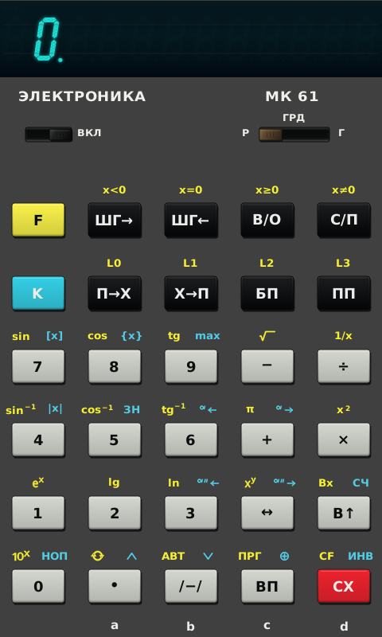
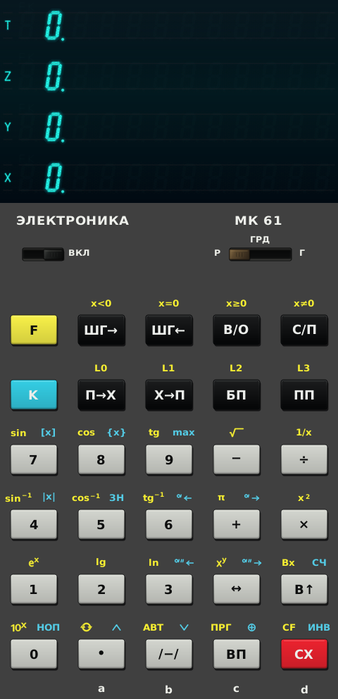

# Elektronika MK-61 Emulator

Native Linux emulation of the Soviet **Elektronika MK-61** and **MK-54**
programmable RPN calculators, written in C++20 and Qt 6.

| Original display | Expanded four-row VFD stack |
|:--:|:--:|
|  |  |

The application executes the original IK13xx microcode model instead of using
modern floating-point calculator logic. Its keyboard matrix, angle selector,
and ИЛЦ2-12/8Л vacuum-fluorescent display are connected to that emulated
hardware state. This is an independent, work-in-progress port; it is not an
official release of PMK-Android, EMU145, or the original manufacturer.

## Current features

- Native Qt Widgets interface with mouse and keyboard input.
- MK-61 and MK-54 model selection.
- Authentic microcode execution, RPN stack, registers, and program memory.
- Hardware-driven VFD rendering and optional four-row `T/Z/Y/X` stack view.
- Import and export of PMK-Android-style mnemonic text programs.
- Linux desktop launcher and scalable application icon.

The native core is derived from EMU145 commit
`02a8286c8e839c4e325982ff4967e89025c6e626`; the behavioral and interface
reference is PMK-Android commit
`100eea1e325fcf85f0d029780b9c079793a73075`.

## Build

Requirements: CMake 3.20+, a C++20 compiler, and Qt 6 Widgets development
files (`qt6-base-dev` on Debian/Ubuntu).

```sh
cmake -S . -B build -DCMAKE_BUILD_TYPE=Release
cmake --build build -j
./build/elektronika-mk61
```

Install for the current user:

```sh
./install.sh
```

This installs the executable as `~/.local/bin/elektronika-mk61`, the launcher
under `~/.local/share/applications`, and the icon under
`~/.local/share/icons/hicolor`. The desktop and icon caches are refreshed
automatically when the corresponding cache utilities are available. The
launcher follows the freedesktop/XDG layout and does not depend on GNOME, KDE
Plasma, XFCE, LXQt, or another particular desktop environment. Menus normally
notice the new entry automatically; if a running session keeps an old menu
cache, sign out and back in once.

The application can always be started directly with:

```sh
"$HOME/.local/bin/elektronika-mk61"
```

The launcher is generated during installation, so its absolute executable
path follows the selected prefix. To install under another absolute prefix,
pass it as the first argument, for example `./install.sh /opt/elektronika-mk61`
(a system prefix may require administrator privileges).

Uninstall the current-user installation with:

```sh
./uninstall.sh
```

Both scripts are desktop-independent convenience wrappers. The equivalent
standard CMake installation remains available:

```sh
cmake --install build --prefix "$HOME/.local"
```

## Controls

Digits, decimal point/comma, Enter, `+`, `-`, `*`, `/`, Backspace/Escape,
`F`, and `K` map to calculator keys. `R`, `G`, and `D` select radians, grads,
and degrees; `F12` toggles power. Click the powered display to toggle the
four-row stack view. While powered off, click the model name to switch model.

## License

The project is licensed under the [GNU GPL version 3](LICENSE). It contains
adapted GPL-3.0 code and assets from
[EMU145](https://github.com/fixelsan/emu145) and
[PMK-Android](https://github.com/xvadim/pmk-android). Historical ROM ownership
has an unresolved provenance caveat; read [NOTICE](NOTICE) before distributing
binaries. Contributions are described in [CONTRIBUTING.md](CONTRIBUTING.md).
